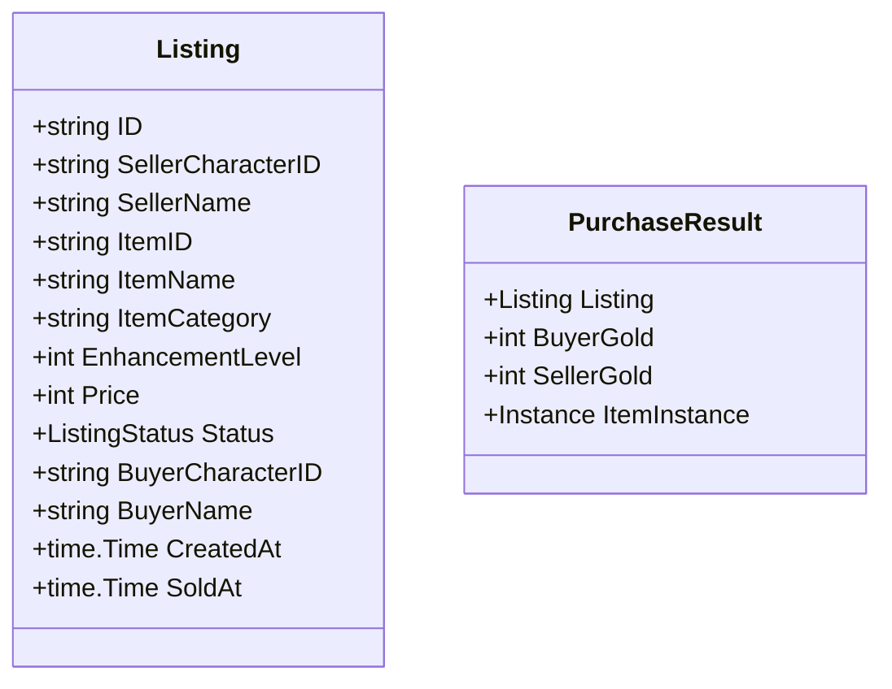

# Flea Market and Player Item Stall Design Specification

## Overview

The Flea Market (`fleamarket`) subsystem cleanly reconstructs and modernizes the original Party2 `free.cgi` ("フリーマーケット") mechanics.
In contrast to the auction hall (live P2P transfer and unscripted bartering venue) and the NPC item shop (fixed 50% resale price), the Flea Market enables players to set up casual player-to-player stalls to list items directly from their **Depot storage (`depot.cgi`)** for direct fixed-price purchase by other adventurers.

---

## 1. Legacy `@actions` Reconciliation Table

Legacy source: `party2/lib/free.cgi`. Commands use the [Action Gateway](../architecture/client-agent-api.md) and observation uses the `fleamarket` scene. All former listing REST routes, including the anonymous listing GETs, are retired and return 404. Legacy shows the market only inside the facility, and Flea Market is not an approved public projection.

| Legacy action | Lines | Go operation | Transport | Disposition |
|---|---|---|---|---|
| `しゅっぴん` | 52-138 | `CreateListing` | `fleamarket_list` with `item_id`, `price` | Lists one Depot unit at 1-999,999 G. Legacy matches by item name and takes the first row; `item_id` is an instance ID or a definition ID (first match). The legacy prompt listing Depot rows maps to the `depot` scene's instances. |
| `かう` | 143-207 | `PurchaseListing` | `fleamarket_purchase` with `listing_id` | Charges the buyer and delivers to the buyer's Depot. The action returns the purchased `listing`, `buyer_gold` and `item_instance`, omitting the seller's wallet balance. Legacy leaves your own listings out of the prompt; Go rejects them with `FLEAMARKET_OWN_LISTING`. |
| `みる` | 212-237 | `ListActiveListings` | `listings` in the scene | Observation only, with no cooldown, as legacy sets `act_time = 0`. A row carries every fact the legacy table shows, so no detail read replaces the retired one. |
| `もどす` | 242-298 | `CancelListing`, `GetActiveCharacterListings` | `fleamarket_cancel` with `listing_id`; `owned_listings` in the scene | Returns the item to the seller's Depot. Legacy deletes finished rows and offers only active ones, so the former Go read of sold and cancelled history is retired. Those rows stay in the table as records but are not observed. |
| `はなす`, NPC `しらべる` | `system.cgi` shared | `npc_talk`, `npc_inspect` | None | Talk logs one of `@FMGKDP`'s words and starts the action wait; inspect returns the legacy default privately. |

### Known differences

These are recorded, not approved departures:

- **Seller payment**: legacy `send_money` (`free.cgi:174`) holds the money as a pending remittance. Go credits the wallet at purchase, and `AddMoney` clamps at the cap, so excess gold is lost. Owner: #1902.
- **Action wait and facility log**: legacy successful commands keep the default action wait and write the facility log. The Gateway applies the [action wait](../architecture/place-log.md#action-wait-1939); the commands' log rows remain [#1941](https://github.com/witchcraze/party2re/issues/1941).
- **Listing number**: legacy shows the lowest free number. Go uses an opaque listing ID, and order ties use age then ID.

---

## 2. Domain Architecture & Invariants

`PurchaseResult` is the internal domain result returned by `PurchaseListing`. The HTTP action adapter (`fleamarket_purchase`) maps this to a buyer-safe response containing `listing`, `buyer_gold`, and `item_instance`, ensuring the seller's wallet balance (`SellerGold`) is never exposed to the buyer.

### Invariants:
1. **Server-Wide Active Listing Ceiling**: The market enforces a strict server-wide ceiling of at most 120 simultaneous active listings (`ServerMaxListings = 120`, matching `$MAX = 120` in `free.cgi`). If 120 active listings are present, `CreateListing` returns `ErrServerMaxListingsReached`. Creators serialize on the `fleamarket_capacity_lock` row before counting. Locking listing rows cannot do this because READ COMMITTED has no gap locks. Purchase and cancel only free slots, so they do not take it.
2. **Depot-Backed Item Storage**: In accordance with the original Perl implementation, items listed in the flea market originate from the player's Depot (倉庫), are delivered to the buyer's Depot on purchase, and return to the seller's Depot on cancellation. If the recipient's Depot is full, operations return `ErrDepotFull`.
   - Depot auto-initialization on purchase via `depot.FindOrCreate`.
   - Item discovery recording on listing creation via `CollectionRecorder` (legacy `free.cgi:130-132`).
3. **Seller Listing Capacity & OverFlea Expansion**: A character can maintain at most `5 + OverFlea` active listings simultaneously (`MaxListingsPerCharacter = 5`, expanded up to 10 via character `OverFlea` capacity flag).
4. **Price Range Enforcement**: Listing price must be between 1 G and 999,999 G (`MinListingPrice = 1`, `MaxListingPrice = 999999`).
5. **Pessimistic Locking & Deadlock-Free Ordering**:
   - All state mutations execute inside MariaDB transactions (`RunInTx`).
   - Cross-character locks during purchase are acquired strictly in ascending character ID order: `firstCharID < secondCharID`.
   - Complete global lock hierarchy:
     - Rank 0: `fleamarket_capacity_lock` (`LockListingCapacityForUpdate`, creation) or `fleamarket_listings` (`GetListingByIDForUpdate`, purchase and cancel)
     - Rank 2: `characters` (`FindByIDForUpdate`, sorted ascending)
     - Rank 5: `depots` (`FindByCharacterIDForUpdate`)
6. **Self-Purchase Prevention**: Sellers are forbidden from purchasing their own flea market listings (`ErrCannotBuyOwnListing`).
7. **Ownership-Validated Cancellation**: Only the seller who created the listing can cancel it (`ErrUnauthorizedSeller`). Cancelled listings immediately return the item to the seller's Depot.
8. **Instance Attributes**: A listing escrows the unit's enhancement level, and purchase or cancellation delivers an instance with the same level. Legacy rows hold only kind and number, so this is the current instance-preservation contract rather than a legacy rule. Rows from before the column read as level 0.
9. **Compare-And-Swap (CAS) Status Transition**: Listings can only be purchased or cancelled from `active` status. Double purchase or concurrent cancel attempts are rejected cleanly (`ErrListingNotActive`).

---

## 3. Observation

The `fleamarket` scene (`FleaMarketSceneData`) exposes the current page of all active listings, the total, and the actor's own active listings. The seller limit bounds the own list. GET never lists, buys or cancels, and a failed required read fails the whole observation.

Listings follow legacy `list_sort` (`free.cgi:367-404`): item kind (weapon, armor, item), item number, price, then age, with the listing ID keeping pages stable. Listing candidates come from the `depot` scene.

Command rejection codes and schemas: [OpenAPI](../api/openapi.json).

## 4. Database Schema

- `fleamarket_listings`:
  - `id CHAR(32) PRIMARY KEY`
  - `seller_character_id CHAR(32) NOT NULL` (Foreign key to `characters(id) ON DELETE CASCADE`)
  - `seller_name VARCHAR(64) NOT NULL`
  - `item_id VARCHAR(64) NOT NULL`
  - `item_name VARCHAR(64) NOT NULL`
  - `item_category VARCHAR(32) NOT NULL DEFAULT 'misc'`
  - `enhancement_level INT NOT NULL DEFAULT 0`
  - `price INT NOT NULL`
  - `status VARCHAR(32) NOT NULL DEFAULT 'active'`
  - `buyer_character_id CHAR(32) NULL` (Foreign key to `characters(id) ON DELETE SET NULL`)
  - `buyer_name VARCHAR(64) NULL`
  - `created_at TIMESTAMP NOT NULL DEFAULT CURRENT_TIMESTAMP`
  - `sold_at TIMESTAMP NULL`
  - Indexes on `(seller_character_id, status)` and `(status, created_at)`.
- `fleamarket_capacity_lock`: a single row (`id TINYINT PRIMARY KEY`) that creators hold for their transaction. It stores no game state, and the lock statement recreates the row if it is missing.
