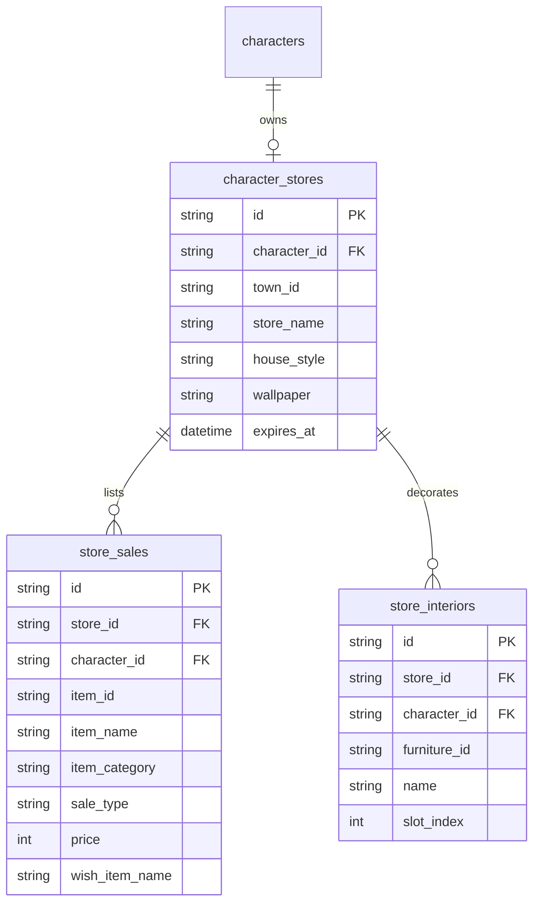

# Player Store and Boutique Design Specification

## Overview

The Player Store (`store`) subsystem reconstructs and modernizes the original Party2 `store.cgi` ("プレイヤーストア / バザール") mechanics.
Player Stores represent permanent commercial real-estate built within the 4 towns (`town1`–`town4`). Adventurers invest substantial capital (50,000 G) to establish their own boutique, listing items from their warehouse (`depot`) for either direct gold purchase or item-for-item barter trade. Store owners can customize their storefront with customized signboard names, decorative wallpapers (50 legacy styles from `%kabes`, 0–50,000 G), and indoor furniture pieces (15 legacy furniture models) with custom labels.

---

## 1. Legacy `@actions` Reconciliation Table

| Legacy Action | Legacy Subroutine | Modern Go Domain Method | Modern HTTP Endpoint | Reconciliation Status & Rationale |
|---|---|---|---|---|
| `建てる` / `みせ` | `&tateru` | `StoreService.BuildStore` | `POST /towns/{town_id}/stores` | **Reconciled (1:1)**: Constructs a store in towns 1–4 for 50,000 G with 90-day maintenance cycle. Awards 900 GP if in a guild. Max 10 stores per town, 1 store per character. |
| `みる` | `&miru` | `StoreService.GetStore` `StoreService.GetTownStores` | `GET /stores/{store_id}` `GET /towns/{town_id}/stores` | **Reconciled (1:1)**: Lists town stores or displays interior, wallpaper, signboard, and active sales catalog. |
| `かくにん` | `&kakunin` | `StoreService.CheckStore` | `GET /characters/{id}/store` | **Reconciled (1:1)**: Inspects personal store status, remaining cycle duration, and active inventory. |
| `売る` (ゴールド) | `&uru_gold` | `StoreService.ListGoldItem` | `POST /characters/{id}/store/listings/gold` | **Reconciled (1:1)**: Lists depot item for direct gold sale (1–999,999 G). Capacity: 10 + `OverStore` * 2 (10–20 items). |
| `売る` (物々交換) | `&uru_barter` | `StoreService.ListBarterItem` | `POST /characters/{id}/store/listings/barter` | **Reconciled (1:1)**: Lists depot item specifying exact desired barter item name. |
| `とりけし` | `&torikesi` | `StoreService.WithdrawListing` | `DELETE /characters/{id}/store/listings/{sale_id}` | **Reconciled (1:1)**: Cancels store listing and returns the item safely to owner's depot. |
| `かう` (ゴールド) | `&kau_gold` | `StoreService.BuyItem` | `POST /characters/{id}/store/sales/{sale_id}/buy` | **Reconciled (1:1)**: Buyer pays listed gold. Gold deposited into seller wallet, item moved into buyer depot. Collection discovery (`RecordItemDiscovered`) triggered for buyer (`party2/lib/store.cgi:175-176`). |
| `かう` (物々交換) | `&kau_barter` | `StoreService.TradeItem` | `POST /characters/{id}/store/sales/{sale_id}/trade` | **Reconciled (1:1)**: Buyer exchanges matching depot item for listed item. Both items transferred atomically. Collection discovery (`RecordItemDiscovered`) triggered for buyer (`party2/lib/store.cgi:276-277`). |
| `かんばん` | `&kanban` | `StoreService.ChangeStoreName` | `POST /characters/{id}/store/name` | **Reconciled (1:1)**: Modifies store signboard name. Max 8 characters, validated and sanitized. Requires 5,000 G wallet balance; under observable legacy parity, no gold is deducted upon success (#1146 decision, verified in #1545). |
| `かべがみ` | `&kabegami` | `StoreService.ChangeWallpaper` | `POST /characters/{id}/store/wallpaper` | **Reconciled (1:1)**: Updates boutique wallpaper from 50 historical styles (`%kabes`) with tier pricing (0–50,000 G), deducted atomically from owner wallet (`lib/store.cgi:593-620`). |
| `おく` (インテリア) | `&oku` | `StoreService.AddInterior` | `POST /characters/{id}/store/interiors` | **Reconciled (1:1)**: Places furniture from 15 available styles (`001`–`023`), max 5 interiors. Requires 1,000 G wallet balance; under observable legacy parity, no gold is deducted upon success (#1146 decision, verified in #1545). |
| `なづける` | `&nazukeru` | `StoreService.RenameInterior` | `PUT /characters/{id}/store/interiors/{interior_id}/name` | **Reconciled (1:1)**: Renames placed furniture piece (max 8 characters). |
| `そうじ` | `&souji` | `StoreService.CleanInteriors` | `DELETE /characters/{id}/store/interiors` | **Reconciled (1:1)**: Clears all placed furniture from the store. |

---

## 2. Domain Architecture & Invariants

### Invariants:
1. **Town Allocation & Quotas**:
   - Stores can only be built in towns `town1`, `town2`, `town3`, `town4`.
   - Maximum of 10 stores allowed per town (`MaxTownStores = 10`).
   - One character can own at most one store (`ErrStoreAlreadyExists`).
2. **Maintenance Cycle & Timers**:
   - Initial construction duration is 90 days (`StoreCycleDays = 90`).
   - Store timer registered under timer category `store` in `timers` table.
   - When 90 days expire without renewal, store is marked expired (`ErrStoreExpired`).
3. **Listing Capacities & Mechanics**:
   - Base listing capacity is 10 items.
   - Characters with `OverStore` attribute expand capacity: `10 + OverStore * 2` (up to 20 maximum).
   - Only unequipped, stored items from `depot` can be placed into the store.
4. **Pessimistic Locking & Deadlock-Free Ordering**:
   - Cross-character and cross-inventory transactions strictly adhere to the system Lock Hierarchy (`internal/database/lock_hierarchy_lint_test.go`):
     - **Rank 0**: `store_sales` (`GetSaleByIDForUpdate`) - Shared peer entity.
     - **Rank 2**: `characters` (`FindByIDForUpdate`) - Locked in ascending lexical ID order: `min(id1, id2)` -> `max(id1, id2)`.
     - **Rank 5**: `depots` (`FindByCharacterIDForUpdate`) - Locked in ascending character ID order: `min(id1, id2)` -> `max(id1, id2)`.
5. **Interior & Customization Limits**:
   - Max 5 furniture pieces per store (`MaxInteriorCount = 5`).
   - Customization charges (#1146): Wallpaper incurs actual gold deductions (0–50,000 G) per style. Signboard renaming (5,000 G threshold) and furniture interior placement (1,000 G threshold) require minimum wallet balance gates, but do not deduct gold from the character's wallet in accordance with observable legacy parity.
   - Store and interior names cannot exceed 8 characters and are validated against reserved delimiters.
6. **Collection Discovery & Catalog Registration**:
   - Acquiring items or equipment through player store purchases (`BuyItem`) or barter exchanges (`TradeItem`) triggers collection discovery (`RecordItemDiscovered`) for the buyer character, registering the acquired item, weapon, or armor in their personal collection compendium (`party2/lib/store.cgi:175-176, 276-277`).
7. **Action Gateway & Sleep/Rescue Guards**:
   - All player store state-mutating operations (store construction, listing items, withdrawing listings, purchasing, trading, changing store name, changing wallpaper, placing furniture, renaming furniture, and cleaning interiors) require an awake character. Requests from sleeping or rescue-recovering characters are rejected with HTTP 409 Conflict.

---

## 3. Store Customization Charges and Legacy Parity Decision (#1146)

### Legacy Requirements and Provenance

In the original Party2 implementation (`/home/witchcraze/dev/party2/party2/`):

1. **Signboard Renaming (`party2/lib/store.cgi:289-313`, `sub kanban`)**:
   - UI display: prompts that renaming requires `$NAME_CHANGE_MONEY` G (`店名の変更には $NAME_CHANGE_MONEY G必要です`, where `$NAME_CHANGE_MONEY = 5000` in `party2/lib/store.cgi:30`).
   - Balance guard: `if $NAME_CHANGE_MONEY > $m{money};` halts execution with message `店名変更代の $NAME_CHANGE_MONEY Gが足りません`.
   - Execution & State mutation: invokes `write_stores_name($target)` and `write_town_member(...)`.
   - **Observable legacy behavior**: neither `kanban` nor the common action dispatcher `party2/lib/system.cgi:639-655` (`sub action`) executes `$m{money} -= $NAME_CHANGE_MONEY`. No gold is deducted; the check functions solely as a balance threshold qualification.
2. **Furniture Interior Placement (`party2/lib/store.cgi:626-661`, `sub interior`)**:
   - UI display: prompts `インテリアの値段 $interior_price G / どのインテリアを置きますか？` (where `$interior_price = 1000`).
   - Balance guard: `if ( $m{money} < $interior_price )` halts execution with message `ゴールドが足りません`.
   - Capacity guard: `elsif (&is_max_interiors)` halts execution if store already holds 5 interiors (`$MAX_INTERIOR = 5` in `party2/lib/store.cgi:29`).
   - Execution & State mutation: appends `0<>1<>$no<>0<>item/$interior<>$npc_color<>\n` to `$userdir/$yid/store_member.cgi`.
   - **Observable legacy behavior**: neither `interior` nor `sub action` executes `$m{money} -= $interior_price`. No gold is deducted; placement requires 1,000 G in hand but costs 0 G.
3. **Wallpaper Replacement (`party2/lib/store.cgi:593-620`, `sub kabegami`)**:
   - Contrasting reference: checks `if ( $m{money} >= $kabes{$k} )` and explicitly deducts `$m{money} -= $kabes{$k};`. Wallpaper purchases thus genuinely deduct gold.
4. **Display Intent vs Observable Execution**:
   - While legacy user-facing dialogs quote fee prices (5,000 G and 1,000 G), the underlying Perl code omitted deduction statements for signboard and interior actions. Under `.agents/rules/00-migration-constraints.md`, observable legacy behavior is authoritative during reconstruction; discrepancies cannot be assumed away as approved game changes without an explicit decision.

### Approved Reconstruction Rule (#1146)

On 2026-10-19, during kickoff for issue #1146, the user explicitly selected:
> 「原典の観測動作に復元する（看板5,000G・家具1,000Gの残高検査のみ行い、実行時にゴールドを控除しない）」

The approved reconstruction specification is:
- **Signboard Name (`ChangeStoreName`)**: Requires `Money >= 5,000 G` as an admission check. Successful renaming updates `character_stores.store_name` without deducting any gold from the owner's wallet (`0 G` deducted).
- **Furniture Placement (`AddInterior`)**: Requires `Money >= 1,000 G` as an admission check. Successful placement inserts a `store_interiors` record without deducting any gold from the owner's wallet (`0 G` deducted).
- **Wallpaper (`ChangeWallpaper`)**: Retains historical tier deduction (0–50,000 G) matching authentic `lib/store.cgi:606` behavior.

### Expected Wallet Values & Boundary Conditions

| Subsystem / Action | Initial Wallet | Condition / Pre-state | Outcome | Final Wallet | Final Placed Count | Error / HTTP Status |
|---|---|---|---|---|---|---|
| **看板 (ChangeStoreName)** | `4,999 G` | `< 5,000 G` (insufficient) | Rejected | `4,999 G` (unchanged) | N/A | `ErrInsufficientFunds` (HTTP 400) |
| **看板 (ChangeStoreName)** | `5,000 G` | `== 5,000 G` (exact threshold) | Accepted | `5,000 G` (0 G deducted) | N/A | None (HTTP 200) |
| **看板 (ChangeStoreName)** | `50,000 G` | `> 5,000 G` (surplus) | Accepted | `50,000 G` (0 G deducted) | N/A | None (HTTP 200) |
| **看板 (ChangeStoreName)** | Any | Name validation failure (>8 chars, invalid chars/whitespace) | Rejected | Unchanged | N/A | `ErrInvalidStoreName` (HTTP 400) |
| **看板 (ChangeStoreName)** | Any | Store name taken / collision with active store | Rejected | Unchanged | N/A | `ErrStoreNameTaken` (HTTP 409) |
| **家具 (AddInterior)** | `999 G` | `< 1,000 G` (insufficient), slots < 5 | Rejected | `999 G` (unchanged) | Unchanged | `ErrInsufficientFunds` (HTTP 400) |
| **家具 (AddInterior)** | `1,000 G` | `== 1,000 G` (exact threshold), slots < 5 | Accepted | `1,000 G` (0 G deducted) | `+1` | None (HTTP 201) |
| **家具 (AddInterior)** | `10,000 G` | `> 1,000 G` (surplus), slots < 5 | Accepted | `10,000 G` (0 G deducted) | `+1` | None (HTTP 201) |
| **家具 (AddInterior)** | `1,000 G` | Sequential placement from `0` to `5` items | All 5 Accepted | `1,000 G` (0 G deducted throughout) | `5` | None (HTTP 201 x 5) |
| **家具 (AddInterior)** | `>= 1,000 G` | Store already at cap (`5` items placed) | Rejected | Unchanged | `5` (unchanged) | `ErrMaxInteriorsReached` (HTTP 409) |

### Implementation and Verification (Issue #1545)

Resolved and verified in Issue #1545:
1. `ChangeStoreName` verifies `char.Money >= NameChangePrice` (5,000 G) admission qualification without deducting money from character wallet.
2. `AddInterior` verifies `char.Money >= InteriorPrice` (1,000 G) admission qualification without deducting money from character wallet.
3. `store_test.go` (`TestStoreCustomization`, `TestStoreCustomization_ZeroCostAndBoundary`) verifies wallet preservation on success, boundary rejection on insufficient balance (<5,000 G, <1,000 G), exact threshold balance (=5,000 G, =1,000 G), and sequential placement of 5 pieces with exactly 1,000 G balance without deduction.

